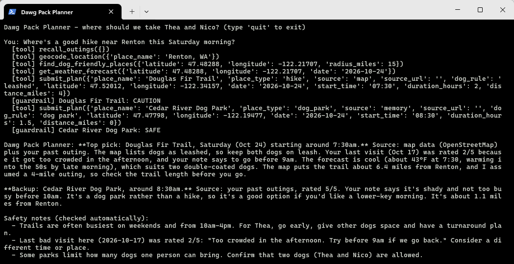
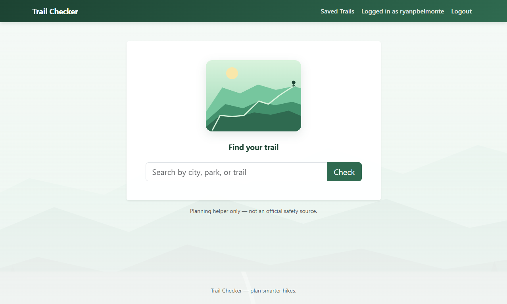
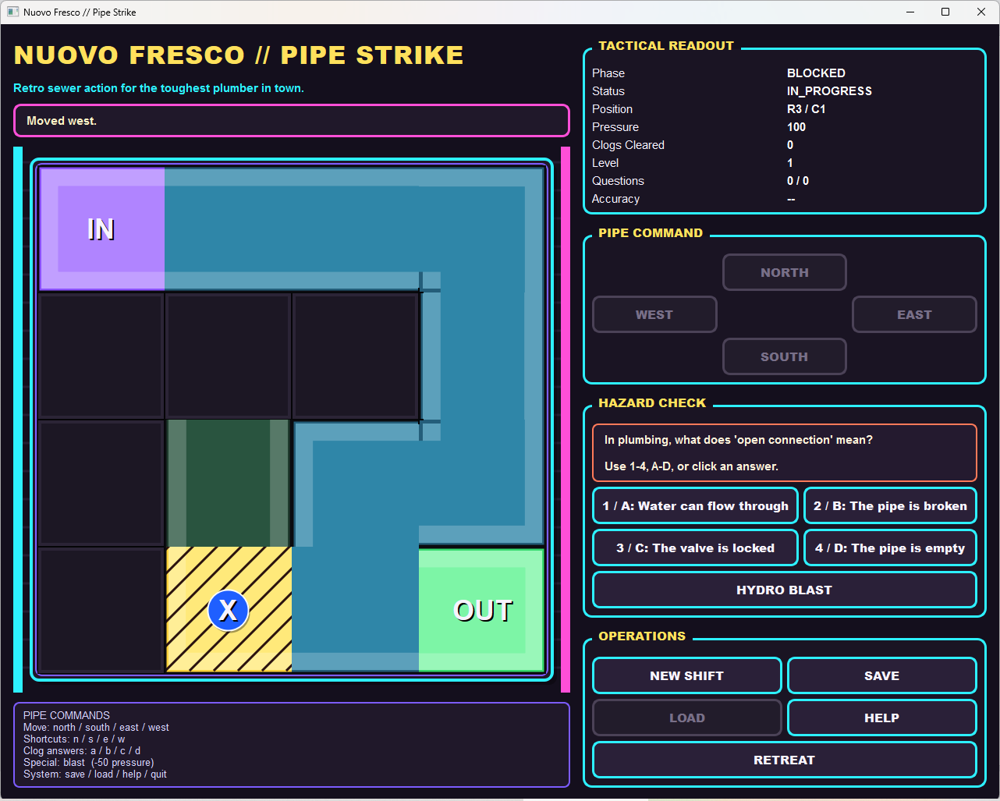

# Hi, I'm Ryan Belmonte

Software engineer with a Graduate Certificate in Software Development Engineering (UW Tacoma, 2026).
I build backend and full-stack applications in **Python, Flask, PostgreSQL, Docker, and AWS**,
with automated testing and CI, and AI agents on the **Claude API** with code-enforced guardrails
and evals. Previously 15+ years delivering production systems in healthcare
(Epic, FHIR, OAuth integrations, regulated go-lives).

## Featured projects

### Dawg Pack Planner (AI agent)

Solo project — **design, build and evaluation**  
Python · Claude API (tool use, no framework) · code-enforced safety guardrails · prompt-injection defenses · eval suite (12 scenarios × 3 runs, 100% safety) · GitHub Actions (weekly scheduled run + CI, 70 tests)

[Repo](https://github.com/ryanpbelmonte/dawg-pack-planning-agent) · [Eval scorecard](https://github.com/ryanpbelmonte/dawg-pack-planning-agent/blob/main/evals/SCORECARD.md)

*Sample run in the README* — see screenshot below.

### Trail Conditions Checker (Web app)

3-person team capstone — **server-side/API owner**  
Flask · PostgreSQL · OpenWeather REST APIs · GitHub OAuth · Docker Compose · nginx/gunicorn on AWS EC2 · pytest + Playwright CI (52 tests)

[Repo](https://github.com/ryanpbelmonte/trail-conditions-checker-capstone)

*Demo available on request* — see screenshot below.

### Nuovo Fresco Pipe Network (Trivia Maze)

3-person team project — **persistence/architecture owner**  
Python · SQLModel/SQLite · pytest (116 tests) · PyQt6 GUI · contract-driven module boundaries

[Repo](https://github.com/nstjern-uw/TCSS504_TriviaMaze_CacheKings)

*Demo available on request* — see screenshot below.

## Connect

- [LinkedIn](https://www.linkedin.com/in/ryan-belmonte/)
- [Portfolio](https://ryan.belmonte.us.com/)
- Software Engineer · Backend · Full Stack · Integration/Platform · AI Agents
